# Enterprise-Grade CI/CD on AWS ECS Fargate

[](LICENSE)


A small Node.js service delivered through a production-style pipeline:
**GitHub Actions → Docker → Amazon ECR → ECS Fargate behind an Application Load Balancer**, with all infrastructure in **Terraform**.
Every push to `main` is tested, containerised, pushed to ECR and rolled out to ECS with a verified, auto-rolling-back deployment, using **no long-lived AWS credentials**.

> **Status:** the AWS environment was torn down after testing to avoid costs. The evidence is in the screenshots below and in the
> [full project PDF](docs/ECS-Fargate-CICD-Project-Evidence.pdf). The Terraform recreates everything in about 10 minutes (see [Deploy it yourself](#deploy-it-yourself)).

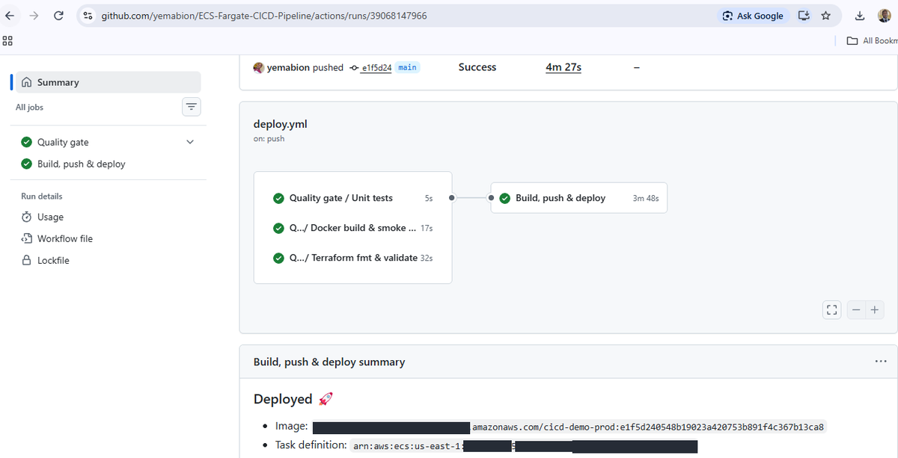

## Highlights

| Area | What it does |
|---|---|
| **Keyless auth** | GitHub OIDC gives short-lived AWS credentials. The IAM role trusts only this repository and the `production` environment, with a least-privilege deploy policy. |
| **Traceable releases** | ECR tags are immutable and equal the commit SHA, so any running container maps back to the commit that built it. Scan-on-push and a lifecycle policy are enabled. |
| **Verified deployments** | The pipeline registers a new task-definition revision, runs `aws ecs update-service`, then polls until the new deployment is `COMPLETED`. The ECS circuit breaker rolls back automatically if tasks fail to become healthy. |
| **Quality gate** | Unit tests, a container smoke test and `terraform fmt`/`validate` must pass before anything is pushed or deployed. |
| **Resilience** | Two Availability Zones, at least two tasks, rolling deploys at 100% minimum healthy, and CPU target-tracking autoscaling. |
| **Security** | Non-root container with read-only root filesystem, tasks reachable only from the ALB security group, locked default security group, VPC flow logs, encrypted and versioned remote state. |
| **Observability** | Structured JSON logs in CloudWatch, Container Insights, and alarms for unhealthy targets and 5xx errors. |

## Architecture

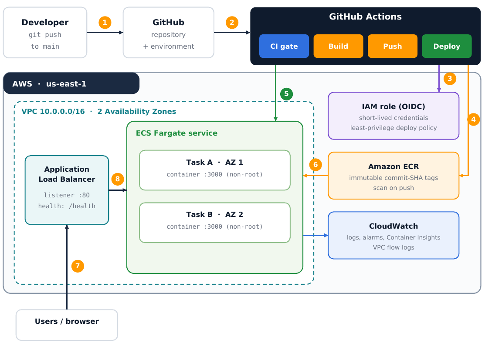

1. A developer pushes to `main`.
2. GitHub triggers the workflow.
3. The deploy job requests an OIDC token and assumes a short-lived AWS role.
4. The image is pushed to ECR, tagged with the commit SHA.
5. A new task-definition revision is registered and the ECS service is updated.
6. Fargate pulls the image from ECR.
7. Users reach the application through the load balancer.
8. The ALB forwards to healthy tasks on port 3000.

### Deployment pipeline

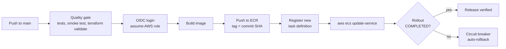

## Evidence

| | |
|---|---|
| 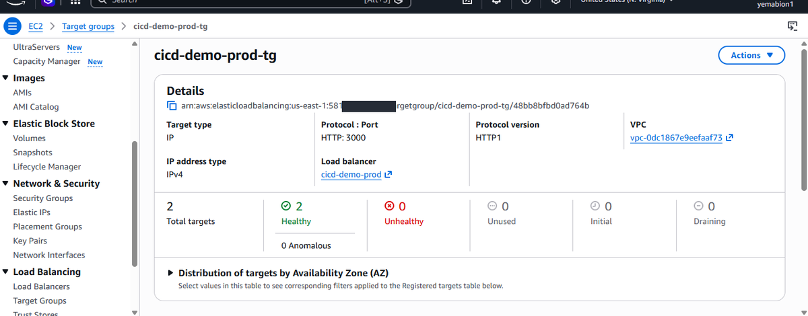 **Load balancer targets: 2 healthy** | 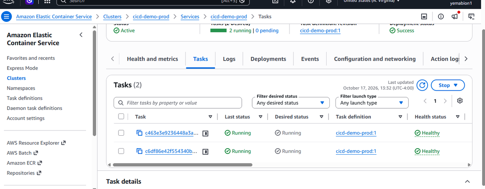 **ECS service: 2 tasks running** |
| 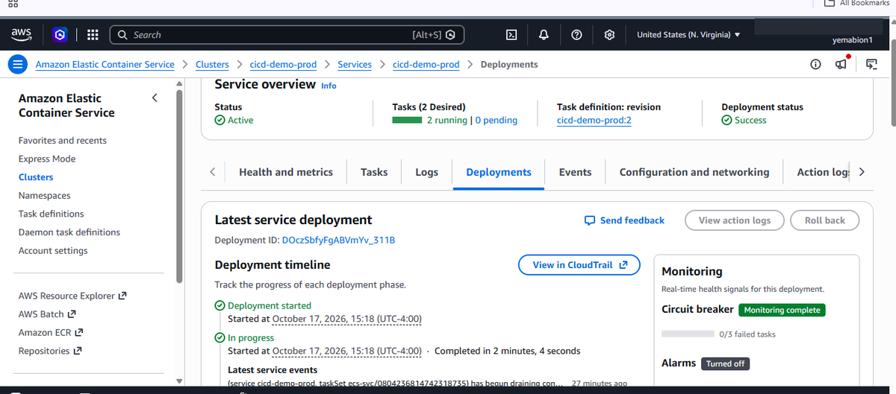 **Deployment succeeded, 0/3 failed tasks** | 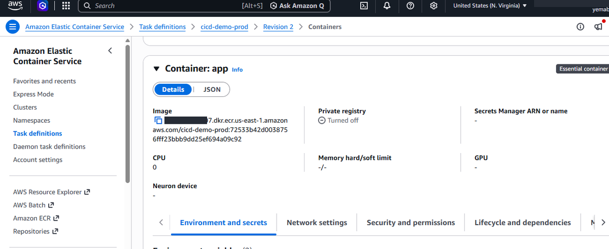 **Image tagged with the commit SHA** |
| 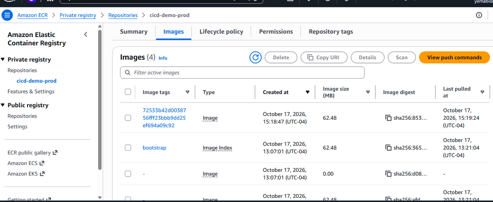 **ECR: bootstrap image plus pipeline-built SHA tags** | 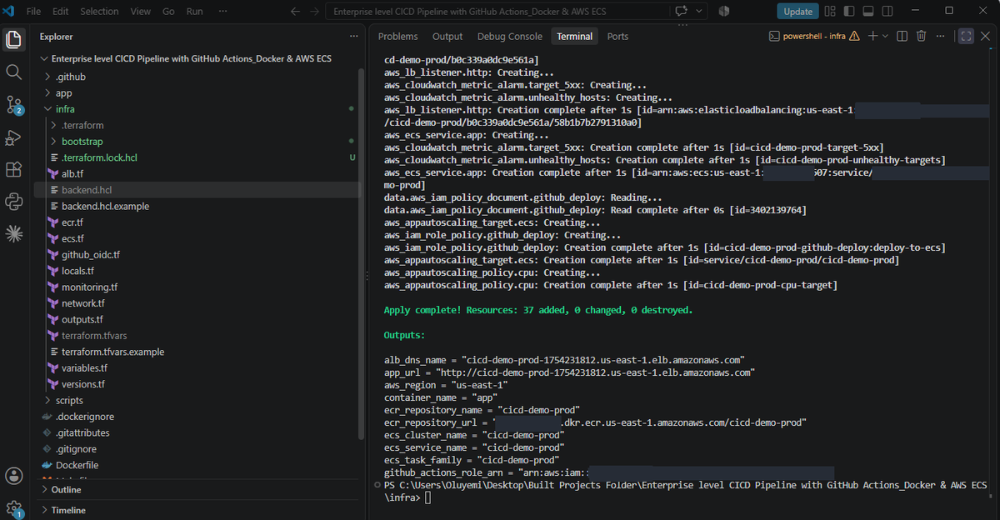 **`terraform apply`: 37 resources created** |

The complete walkthrough, with 33 captioned figures, is in
[`docs/ECS-Fargate-CICD-Project-Evidence.pdf`](docs/ECS-Fargate-CICD-Project-Evidence.pdf).

## Problems met and solved

**1. AWS rejected the GitHub OIDC login** (`Not authorized to perform sts:AssumeRoleWithWebIdentity`).
A temporary debug step decoded the token claims and showed the `sub` claim now carries numeric owner and repository IDs for newer repositories, which my trust policy did not expect.
The trust policy now accepts both formats (`github_owner_id` / `github_repo_id`).

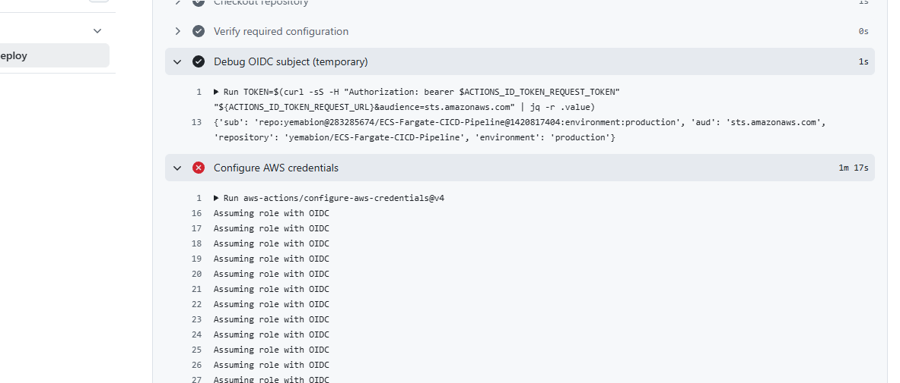

**2. ECR refused to overwrite a released image.** Re-running a deployed commit fails with `tag invalid ... immutable`.
This is deliberate: a released tag can never be silently replaced. Release again with a new commit, or roll back by pointing the service at an earlier task definition.

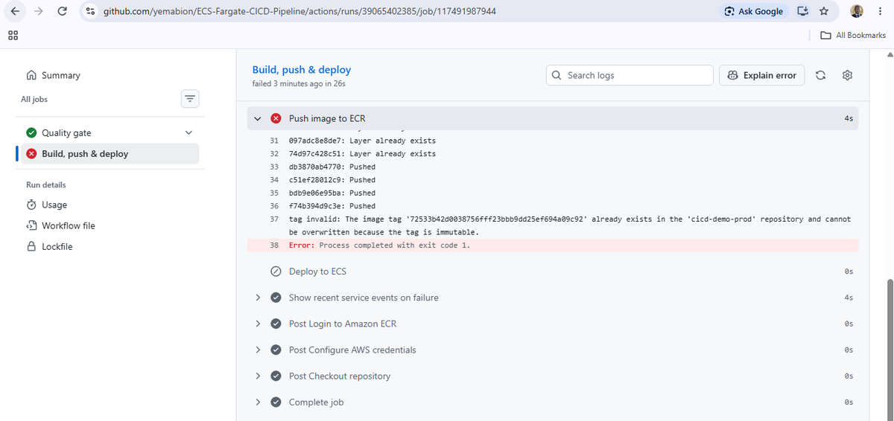

**3. The deploy check raced ECS's own state change.** `aws ecs wait services-stable` returned while the rollout was still `IN_PROGRESS`, and a single check failed a healthy deployment.
The pipeline now polls every 10 seconds until the rollout is `COMPLETED`, failing fast on `FAILED`.

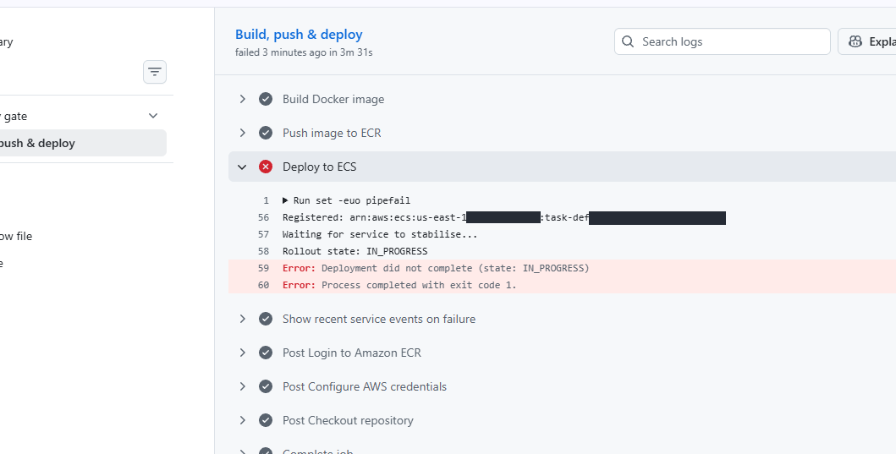

## Repository layout

```
.
├── app/                    # Node.js service (no dependencies) and unit tests
├── Dockerfile              # slim, non-root image with a health check
├── infra/                  # Terraform: VPC, ALB, ECR, ECS, IAM, OIDC, alarms
│   └── bootstrap/          # one-time S3 bucket for remote state
├── .github/workflows/
│   ├── ci.yml              # pull-request checks and reusable quality gate
│   └── deploy.yml          # main: build, push to ECR, deploy to ECS
├── scripts/                # first-push and GitHub-config helpers (bash)
├── docs/                   # project PDF and README images
└── Makefile
```

## Deploy it yourself

**Prerequisites:** an AWS account and CLI credentials (not root), Terraform 1.10 or newer, Docker, Node.js 22 or newer, Git.
Expect roughly $2 per day while it runs (ALB plus two Fargate tasks), so set a billing alert first and destroy it when done.

### 1. Run locally

```bash
cd app && npm test && npm start        # http://localhost:3000
docker build -t hello-cicd:local .
docker run --rm -p 3000:3000 hello-cicd:local
```

### 2. Create the remote state bucket (once)

```bash
cd infra/bootstrap
terraform init
terraform apply -var "state_bucket_name=<globally-unique-name>"
```

### 3. Configure Terraform

```bash
cd infra
cp backend.hcl.example backend.hcl            # set your bucket name
cp terraform.tfvars.example terraform.tfvars  # set github_repository, owner and repo IDs
```

Newer repositories include numeric IDs in their OIDC token, so also set `github_owner_id` and `github_repo_id`.
Find them with the GitHub CLI: `gh api users/<owner> --jq .id` and `gh api repos/<owner>/<repo> --jq .id`.
If your AWS account already has a GitHub OIDC provider, set `create_github_oidc_provider = false`.

### 4. Provision

The ECS service needs an image to start, so create ECR first and push a bootstrap image:

```bash
terraform init -backend-config=backend.hcl
terraform apply -target=aws_ecr_repository.app
../scripts/first-push.sh                       # bash; PowerShell equivalent below
terraform apply
```

### 5. Connect GitHub

Add these **repository variables** (Settings → Secrets and variables → Actions → Variables) from `terraform output`:
`AWS_REGION`, `AWS_ROLE_ARN` (`github_actions_role_arn`), `ECR_REPOSITORY`, `ECS_CLUSTER`, `ECS_SERVICE`, `ECS_TASK_FAMILY`, `CONTAINER_NAME`.
Or run `./scripts/set-github-config.sh` with the GitHub CLI. Re-enable the **Build & Deploy to ECS** workflow if it is disabled, then push to `main`.

```bash
curl "$(terraform -chdir=infra output -raw app_url)"   # Hello from CI/CD Pipeline!
```

### 6. Tear down

```bash
terraform -chdir=infra destroy
```

### Windows / PowerShell notes

- Quote Terraform arguments containing a dot: `terraform init "-backend-config=backend.hcl"` and `terraform apply "-target=aws_ecr_repository.app"`.
- `docker login` through a pipe can fail in PowerShell with `400 Bad Request`. Use:

```powershell
$REPO = terraform output -raw ecr_repository_url
$REGISTRY = $REPO.Split('/')[0]
$PW = aws ecr get-login-password --region us-east-1
docker login --username AWS --password $PW $REGISTRY
docker build --platform linux/amd64 -t "${REPO}:bootstrap" ..
docker push "${REPO}:bootstrap"
```

## Next steps for a real production system

- HTTPS: domain, ACM certificate, HTTPS listener and an 80 to 443 redirect.
- Private subnets with VPC endpoints (ECR, S3, Logs) and no public task IPs; AWS WAF and ALB access logs.
- Skip the push when the tag already exists, and run smoke tests against new tasks before shifting traffic.
- `terraform plan` on pull requests with a read-only role; pin Actions and the base image by digest; image signing.

## License

[MIT](LICENSE)
