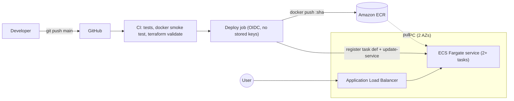

# CI/CD Pipeline: GitHub Actions → Docker → Amazon ECR → ECS Fargate (Terraform)

A small Node.js service (`Hello from CI/CD Pipeline!`) delivered through a production-style
pipeline. Every push to `main` is tested, built into a Docker image, pushed to ECR and
rolled out to ECS Fargate behind an Application Load Balancer, with automatic rollback.



## Repository layout

```
.
├── app/                    # Node.js service (zero dependencies) + tests
├── Dockerfile              # multi-arch-safe, non-root, healthcheck
├── infra/                  # Terraform (VPC, ALB, ECR, ECS, IAM, OIDC, alarms)
│   └── bootstrap/          # one-time S3 bucket for remote state
├── .github/workflows/
│   ├── ci.yml              # PR checks + reusable quality gate
│   └── deploy.yml          # main: build → ECR → ECS
├── scripts/                # first-push + GitHub config helpers
└── Makefile
```

## What "enterprise level" means here

| Area | Implementation |
|---|---|
| Auth | GitHub OIDC → short-lived AWS credentials; role trusted only for this repo + `production` environment; least-privilege deploy policy |
| Supply chain | Immutable ECR tags (commit SHA), scan-on-push, lifecycle policy, Dependabot for actions/docker/npm/terraform |
| Reliability | 2 AZs, ≥2 tasks, rolling deploy (100% min healthy), **circuit-breaker auto-rollback**, pipeline verifies rollout is `COMPLETED` (not just "stable"), CPU autoscaling |
| Security | Non-root container, read-only root FS, tasks reachable only from the ALB SG, default SG locked, ALB drops invalid headers, VPC flow logs, encrypted+versioned state bucket |
| Observability | JSON logs → CloudWatch, Container Insights, alarms for unhealthy targets and 5xx (SNS) |
| Delivery | Concurrency lock (one deploy at a time), PR validation, tests gate deploys, Terraform fmt/validate in CI, remote state with locking |

## Prerequisites

AWS account + CLI configured with admin-level credentials (for the initial Terraform run),
Terraform ≥ 1.10, Docker, Node.js ≥ 22, Git, and optionally the GitHub CLI (`gh`).

## 1. Run locally

```bash
cd app && npm test && npm start          # http://localhost:3000
# or
docker build -t hello-cicd:local .
docker run --rm -p 3000:3000 hello-cicd:local
curl http://localhost:3000               # Hello from CI/CD Pipeline!
```

## 2. Create the remote state bucket (once)

```bash
cd infra/bootstrap
terraform init
terraform apply -var 'state_bucket_name=<globally-unique-name>'
```

## 3. Provision the infrastructure

```bash
cd infra
cp backend.hcl.example backend.hcl            # put your bucket name in
cp terraform.tfvars.example terraform.tfvars  # set github_repository = "owner/repo"
terraform init -backend-config=backend.hcl

# The ECS service needs an image to start, so create ECR first...
terraform apply -target=aws_ecr_repository.app
../scripts/first-push.sh                       # pushes tag "bootstrap"
# ...then everything else
terraform apply
```

If your AWS account already has a GitHub OIDC provider, set `create_github_oidc_provider = false`.

## 4. Configure GitHub

Either run `./scripts/set-github-config.sh` (requires `gh`), or add these **repository variables**
(Settings → Secrets and variables → Actions → Variables) from `terraform output`:

| Variable | Terraform output |
|---|---|
| `AWS_REGION` | `aws_region` |
| `AWS_ROLE_ARN` | `github_actions_role_arn` |
| `ECR_REPOSITORY` | `ecr_repository_name` |
| `ECS_CLUSTER` | `ecs_cluster_name` |
| `ECS_SERVICE` | `ecs_service_name` |
| `ECS_TASK_FAMILY` | `ecs_task_family` |
| `CONTAINER_NAME` | `container_name` |

Recommended: Settings → Environments → `production` → restrict to branch `main` (and add
required reviewers if you want manual approval). Enable branch protection on `main`
requiring the **CI** checks.

## 5. Deploy

```bash
git push origin main
```

Watch **Actions → Build & Deploy to ECS**. When it finishes:

```bash
terraform -chdir=infra output app_url
curl "$(terraform -chdir=infra output -raw app_url)"   # Hello from CI/CD Pipeline!
```

### Pipeline steps (deploy.yml)

1. Checkout → 2. CI gate (tests, container smoke test, Terraform validate)
3. Assume AWS role via OIDC (`aws-actions/configure-aws-credentials`) → 4. ECR login
5. `docker build` from the repo Dockerfile → 6. `docker push` tagged with the commit SHA
7. Register a new task-definition revision with the new image → `aws ecs update-service`
8. `aws ecs wait services-stable`, then assert the new deployment is `COMPLETED`.

## 6. Screenshot checklist for the PDF

| # | Screenshot | Where |
|---|---|---|
| 1 | App running locally | terminal + browser at `localhost:3000` |
| 2 | Docker build success | `docker build` output |
| 3 | Container running | `docker ps` + `curl localhost:3000` |
| 4 | ECR repository with image | AWS Console → ECR → repo → Images |
| 5 | ECS cluster with running task | ECS → Clusters → service → Tasks (RUNNING) |
| 6 | Target group healthy | EC2 → Target Groups → Targets (healthy) |
| 7 | Terraform apply output | terminal (`Apply complete!` + outputs) |
| 8 | GitHub Actions success | Actions run page, all jobs green |
| 9 | Deployed app via ALB DNS | browser at `http://<alb-dns>` (URL bar visible) |
| 10 | Repo structure | GitHub repo main page |

Tip: include timestamps/account ID in frame, and blur nothing except secrets.

## Teardown

```bash
terraform -chdir=infra destroy
```
(`ecr_force_delete = true` by default so a non-empty repo can be removed. The state bucket has
`prevent_destroy`; delete it manually if you want it gone.)

## Cost note

ALB (~$16-20/mo) + 2 Fargate tasks (~$18/mo) + logs. Destroy when you're done.

## Hardening for a real production system

- Add a domain + ACM certificate: HTTPS listener on 443, redirect 80→443.
- Private subnets for tasks + NAT or VPC endpoints (ECR, S3, Logs) and set `assign_public_ip = false`.
- Set `alb_deletion_protection = true`, `ecr_force_delete = false`; add ALB access logs and AWS WAF.
- Pin GitHub Actions and the base image by SHA/digest.
- Separate AWS accounts per environment; run `terraform plan` on PRs via a read-only role.

## Troubleshooting

| Symptom | Fix |
|---|---|
| `Not authorized to perform sts:AssumeRoleWithWebIdentity` | `github_repository` in tfvars must match `owner/repo` exactly; deploy job must use environment `production` |
| Tasks stuck `PENDING` / `CannotPullContainerError` | Image tag `bootstrap` missing in ECR, or image built for ARM. Re-run `scripts/first-push.sh` |
| Target group unhealthy | Check CloudWatch log group `/ecs/cicd-demo-prod`; health path is `/health` on port 3000 |
| Pipeline red with "Deployment did not complete" | Circuit breaker rolled back; see service events and task logs |
| OIDC provider already exists | `create_github_oidc_provider = false` |
